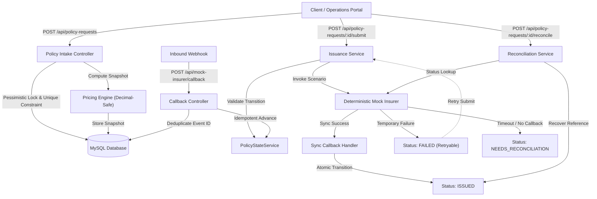

# PolicyFlow: Fault-Tolerant Insurance Issuance & Reconciliation Engine

PolicyFlow is an enterprise travel insurance issuance and reconciliation engine engineered to solve real-world distributed systems challenges: concurrent duplicate intake requests, network drops, unconfirmed provider issuances, out-of-order webhook callbacks, and floating-point financial discrepancies.

Built with **Laravel 11 (PHP 8.2+)** and **React + Vite (TypeScript)**, the system features a strict finite state machine, deterministic decimal-safe pricing, database-level idempotency guards, and an automated reconciliation engine.

---

## 📑 Table of Contents
1. [System Architecture](#-system-architecture)
2. [Prerequisites](#-prerequisites)
3. [Windows / XAMPP Setup Guide](#-windows--xampp-setup-guide)
4. [Environment Variables](#-environment-variables)
5. [API Documentation & HTTP Status Codes](#-api-documentation--http-status-codes)
6. [Pricing Engine & Rate Matrix](#-pricing-engine--rate-matrix)
7. [Finite State Machine & State Lifecycle](#-finite-state-machine--state-lifecycle)
8. [Mock Insurer Scenarios & Edge Cases](#-mock-insurer-scenarios--edge-cases)
9. [Timeout Reconciliation Workflow](#-timeout-reconciliation-workflow)
10. [Concurrency & Idempotency Safeguards](#-concurrency--idempotency-safeguards)
11. [Testing & Verification](#-testing--verification)
12. [Postman Collection](#-postman-collection)
13. [Known Limitations](#-known-limitations)

---

## 🏛️ System Architecture



### Component Structure
* **`backend/`**: Laravel 11 REST API
  * **Controllers**: `PolicyRequestController`, `MockInsurerCallbackController`
  * **Domain Services**: `PricingService`, `PolicyService`, `PolicyStateService`, `IssuanceService`, `MockInsurerService`
  * **Models**: `PolicyRequest`, `IssuanceAttempt`, `ProviderEvent`, `PolicyStateHistory`
  * **Automated Tests**: 44 unit and feature test cases with 167 assertions.
* **`frontend/`**: React 18 + Vite + Tailwind CSS Operations Dashboard
  * Real-time metrics overview, responsive policy intake form with live quote preview, sortable and filterable policy repository table, and comprehensive policy lifecycle inspection modal.

---

## 💻 Prerequisites

Ensure your system meets the following software requirements:
* **Operating System**: Windows 10/11, macOS, or Linux
* **PHP**: 8.2+ with extensions: `pdo`, `pdo_mysql`, `mbstring`, `bcmath`, `curl`, `openssl`
* **Composer**: 2.x
* **Node.js**: 20.x or 22.x
* **npm**: 10.x
* **Database**: MySQL 8.0+ (via XAMPP, Docker, or native service)

---

## 🛠️ Windows / XAMPP Setup Guide

### 1. Database Setup via XAMPP
1. Open **XAMPP Control Panel** and start **Apache** and **MySQL**.
2. Open your browser to `http://localhost/phpmyadmin` (or run MySQL CLI):
   ```sql
   CREATE DATABASE policyflow CHARACTER SET utf8mb4 COLLATE utf8mb4_unicode_ci;
   ```

### 2. Backend Startup (Laravel)
```bash
# Navigate to the backend folder
cd backend

# Install PHP dependencies
composer install

# Create environment configuration from template
cp .env.example .env

# Generate application encryption key
php artisan key:generate

# Run database migrations
php artisan migrate

# Verify database connection and run tests
php artisan test

# Start the local development API server
php artisan serve
```
* The Laravel API will run at **`http://localhost:8000`**.

### 3. Frontend Startup (React + Vite)
```bash
# Open a new terminal and navigate to the frontend folder
cd frontend

# Create frontend environment file
cp .env.example .env

# Install dependencies (or uses existing linked node_modules)
npm install

# Build production bundle to verify types
npm run build

# Start Vite development server
npm run dev
```
* The Operations Dashboard will run at **`http://localhost:5173`**.

---

## ⚙️ Environment Variables

### Backend (`backend/.env.example`)
| Key | Default Value | Description |
|---|---|---|
| `APP_NAME` | `PolicyFlow` | Application name |
| `APP_ENV` | `local` | Environment (`local`, `production`) |
| `APP_DEBUG` | `true` | Detailed stack traces for debugging |
| `APP_URL` | `http://localhost:8000` | Backend base URL |
| `FRONTEND_URL`| `http://localhost:5173` | Allowed CORS origin for React frontend |
| `DB_CONNECTION`| `mysql` | Database driver |
| `DB_HOST` | `127.0.0.1` | MySQL server host |
| `DB_PORT` | `3306` | MySQL server port |
| `DB_DATABASE` | `policyflow` | Target database name |
| `DB_USERNAME` | `root` | MySQL user (default XAMPP: root) |
| `DB_PASSWORD` | *(empty)* | MySQL password (default XAMPP: empty) |

### Frontend (`frontend/.env.example`)
| Key | Default Value | Description |
|---|---|---|
| `VITE_API_BASE_URL` | `http://localhost:8000/api` | Base URL of the Laravel API gateway |

> [!NOTE]
> `.env` files are strictly excluded from source control via `.gitignore`. Only `.env.example` templates containing placeholders are committed.

---

## 📡 API Documentation & HTTP Status Codes

### Endpoints Overview

| Method | Endpoint | Description | Status Codes |
|---|---|---|---|
| `GET` | `/api/health` | System health & DB connectivity check | `200` |
| `GET` | `/api/status` | Simple liveness probe | `200` |
| `POST` | `/api/policy-requests` | Intake policy request (Idempotent) | `201`, `200`, `422` |
| `GET` | `/api/policy-requests` | List paginated policies (optional `?status=` filter) | `200`, `422` |
| `GET` | `/api/policy-requests/{id}` | Get policy details, attempts, history & events | `200`, `404` |
| `POST` | `/api/policy-requests/{id}/submit` | Submit policy to mock insurer | `200`, `404`, `409`, `422` |
| `POST` | `/api/policy-requests/{id}/reconcile` | Reconcile unconfirmed policy | `200`, `404`, `422` |
| `POST` | `/api/mock-insurer/callback` | Webhook for asynchronous provider callbacks | `200`, `404`, `422` |

### HTTP Status Codes Explained
* **`200 OK`**: Request succeeded (idempotent repeated intake, policy details, query lists, successful submission, idempotent reconciliation).
* **`201 Created`**: New policy request successfully registered and quoted for the first time.
* **`404 Not Found`**: Policy ID or matching policy number was not found in database.
* **`409 Conflict`**: Illegal state conflict (e.g. attempting to submit a policy that is already `ISSUED`).
* **`422 Unprocessable Entity`**: Payload validation failed (e.g. `trip_end` before `trip_start`, unsupported destination or plan code, invalid date of birth).

---

### Request & Response Examples

#### 1. Intake Policy Request (`POST /api/policy-requests`)
**Request Body**:
```json
{
  "client_request_id": "REQ-2026-X892",
  "agent_id": "AGENT-17",
  "customer_name": "Sample Customer",
  "date_of_birth": "1998-04-10",
  "destination": "INTERNATIONAL",
  "trip_start": "2026-11-10",
  "trip_end": "2026-11-14",
  "plan_code": "PLUS",
  "sum_insured": 300000,
  "currency": "INR"
}
```

**Response (First Intake — `201 Created`)**:
```json
{
  "data": {
    "id": 1,
    "client_request_id": "REQ-2026-X892",
    "agent_id": "AGENT-17",
    "policy_number": "POL-20261024-8F3A12",
    "status": "RECEIVED",
    "customer_name": "Sample Customer",
    "insured_name": "Sample Customer",
    "date_of_birth": "1998-04-10",
    "traveler_age": 28,
    "destination": "INTERNATIONAL",
    "trip_start": "2026-11-10",
    "trip_end": "2026-11-14",
    "trip_days": 5,
    "plan_code": "PLUS",
    "plan": "PLUS",
    "sum_insured": 300000,
    "coverage_type": "300000",
    "premium_amount": "225.00",
    "currency": "INR",
    "premium_snapshot": {
      "version": "1.0.0",
      "calculation_id": "calc_7c0e8620-3351-40be-bd36-54a85faad001",
      "calculated_at": "2026-10-24T00:00:00Z",
      "currency": "INR",
      "traveler_age": 28,
      "age_band": "18-60",
      "trip_days": 5,
      "pricing_inputs": {
        "plan": "PLUS",
        "destination": "INTERNATIONAL",
        "coverage_type": "300000",
        "date_of_birth": "1998-04-10",
        "trip_start": "2026-11-10",
        "trip_end": "2026-11-14"
      },
      "rates_and_multipliers": {
        "base_daily_rate": "20.00",
        "destination_multiplier": "1.80",
        "coverage_multiplier": "1.25",
        "age_multiplier": "1.00"
      },
      "breakdown": {
        "daily_premium": "45.00",
        "total_amount": "225.00"
      },
      "amount": "225.00"
    },
    "created_at": "2026-10-24T00:00:00Z",
    "updated_at": "2026-10-24T00:00:00Z"
  }
}
```

**Response (Repeated Intake — `200 OK`)**:
Returns the exact same JSON record without creating duplicate database rows.

---

#### 2. Submit Policy (`POST /api/policy-requests/{id}/submit`)
**Request Body**:
```json
{
  "mock_scenario": "SUCCESS"
}
```

**Response (`200 OK`)**:
```json
{
  "data": {
    "id": 1,
    "policy_number": "POL-20261024-8F3A12",
    "status": "ISSUED",
    "issuance_attempts": [
      {
        "id": 1,
        "attempt_number": 1,
        "provider_code": "MOCK_INSURER",
        "status": "CALLBACK_DELIVERED",
        "attempted_at": "2026-10-24T00:00:01Z"
      }
    ],
    "state_history": [
      { "from_status": null, "to_status": "RECEIVED", "trigger_event": "POLICY_INTAKE" },
      { "from_status": "RECEIVED", "to_status": "VALIDATED", "trigger_event": "PRE_SUBMIT_VALIDATION" },
      { "from_status": "VALIDATED", "to_status": "SUBMITTED", "trigger_event": "SUBMIT_TO_INSURER" },
      { "from_status": "SUBMITTED", "to_status": "ISSUED", "trigger_event": "CALLBACK_RECEIVED" }
    ]
  }
}
```

---

#### 3. Webhook Callback (`POST /api/mock-insurer/callback`)
**Request Body**:
```json
{
  "event_id": "evt_983214890",
  "event_type": "POLICY_ISSUED",
  "policy_number": "POL-20261024-8F3A12",
  "status": "ISSUED",
  "provider_policy_id": "PRV-POL-7762",
  "issued_at": "2026-10-24T00:00:02Z"
}
```

**Response (`200 OK`)**:
```json
{
  "status": "processed",
  "deduplicated": false,
  "event_id": "evt_983214890",
  "policy_status": "ISSUED"
}
```
*If posted again with the same `event_id`, `"deduplicated": true` is returned without re-processing.*

---

## 🧮 Pricing Engine & Rate Matrix

### Mathematical Formula
$$\text{Premium} = \text{round}\Big(\text{Base Daily Rate} \times \text{Trip Days} \times \text{Age Multiplier} \times \text{Destination Multiplier} \times \text{Coverage Multiplier},\; 2\Big)$$

* **Inclusive Trip Days**: $\text{Trip End} - \text{Trip Start} + 1$ (e.g. 2026-11-01 to 2026-11-01 is 1 day; 2026-11-01 to 2026-11-10 is 10 days).
* **Traveler Age**: Age calculated at `trip_start` date.
* **Precision**: Decimal-safe calculations avoiding IEEE 754 binary floating-point drift. Results stored in decimal(10,2) columns and locked into an immutable JSON snapshot.

### Rate Matrices (Assignment Specifications)

#### 1. Plan Base Daily Rates
| Plan Code | Plan Name | Base Daily Rate (INR) |
|---|---|---|
| `BASIC` | Basic Protection | ₹12.00 / day |
| `PLUS` | Plus Protection | ₹20.00 / day |
| `PREMIUM` | Premium Protection | ₹30.00 / day |

#### 2. Age Multipliers
| Age Band | Multiplier | Description |
|---|---|---|
| 0 – 17 years | 1.10x | Child / Minor cover |
| 18 – 60 years | 1.00x | Standard adult base |
| 61 – 70 years | 1.50x | Senior traveler |
| 71+ years | 2.00x | Super senior traveler |

#### 3. Destination Multipliers
| Destination Code | Destination Region | Multiplier |
|---|---|---|
| `DOMESTIC` | Domestic Travel | 1.00x |
| `INTERNATIONAL` | International Travel | 1.80x |

*(Additional legacy routes `ASIA` (1.20x), `EUROPE` (1.50x), `SCHENGEN` (1.25x), `USA_CANADA` (1.50x), `WORLDWIDE` (2.00x) are supported for backward compatibility).*

#### 4. Sum Insured & Coverage Multipliers
| Sum Insured (INR) | Coverage Multiplier |
|---|---|
| ₹100,000 (₹1 Lakh) | 1.00x |
| ₹300,000 (₹3 Lakhs) | 1.25x |
| ₹500,000 (₹5 Lakhs) | 1.50x |

---

## 🔄 Finite State Machine & State Lifecycle

The policy lifecycle is strictly managed by `PolicyStateService`. Every transition is validated against a directed acyclic state graph and recorded atomically into `policy_state_history`.

```
               ┌───────────────────────┐
               │         null          │
               └──────────┬────────────┘
                          │ (intake)
                          ▼
               ┌───────────────────────┐
               │       RECEIVED        │
               └──────┬─────────┬──────┘
         (valid)      │         │ (validation error)
       ┌──────────────┘         └──────────────┐
       ▼                                       ▼
┌──────────────┐                        ┌──────────────┐
│  VALIDATED   │                        │    FAILED    │◄───┐
└──────┬───────┘                        └──────┬───────┘    │ (error / reject)
       │ (submit)                              │ (retry)    │
       ▼                                       │            │
┌──────────────┐                               │            │
│  SUBMITTED   │───────────────────────────────┘            │
└──────┬───────┴───────────────┬────────────────────────────┤
       │ (sync confirm)        │ (async accept)             │
       │                       ▼                            │
       │            ┌──────────────────────┐                │
       │            │ PENDING_CONFIRMATION │────────────────┤
       │            └──────┬───────────────┘                │
       │                   │ (timeout)                      │
       │                   ▼                                │
       │            ┌──────────────────────┐                │
       │            │ NEEDS_RECONCILIATION │────────────────┤
       │            └──────┬───────────────┘                │
       │                   │ (reconciled)                   │
       ▼                   ▼                                │
┌──────────────────────────────────┐                        │
│              ISSUED              │                        │
│    (TERMINAL — NEVER REGRESSES)  │                        │
└──────────────────────────────────┘                        │
       ▲                                                    │
       └────────────────────────────────────────────────────┘
```

### Transition Validation Rules
* **Terminal Invariant**: Once in `ISSUED`, **no outbound transitions are permitted**. Late error callbacks or network retries targeting an issued policy are logged but strictly prevented from regressing the state.
* **Retry Safety**: Policies in `FAILED` status may transition back to `SUBMITTED` for a safe subsequent attempt.
* **Audit Trail**: Every state change writes `from_status`, `to_status`, `trigger_event`, `actor_type`, `actor_id`, and payload metadata to `policy_state_history`.

---

## 🎭 Mock Insurer Scenarios & Edge Cases

The built-in `MockInsurerService` allows exercising complex failure modes without external dependencies:

| Scenario Code | Insurer Behavior | Expected Lifecycle |
|---|---|---|
| `SUCCESS` | Synchronous immediate issuance. | `RECEIVED` &rarr; `VALIDATED` &rarr; `SUBMITTED` &rarr; `ISSUED` |
| `TEMPORARY_FAILURE` | Fails on attempt #1 with retryable error code; succeeds on subsequent retry attempt. | `SUBMITTED` &rarr; `FAILED` &rarr; (Retry) &rarr; `ISSUED` |
| `TIMEOUT_AFTER_ISSUE` | Provider generates policy, but callback is lost in transit. | `SUBMITTED` &rarr; `NEEDS_RECONCILIATION` &rarr; (Reconcile) &rarr; `ISSUED` |
| `DELAYED_CALLBACK` | Async acceptance (`ACCEPTED_ASYNC`). Callback arrives later. | `SUBMITTED` &rarr; `PENDING_CONFIRMATION` &rarr; (Webhook) &rarr; `ISSUED` |
| `DUPLICATE_CALLBACK` | Repeated webhook delivery with the exact same `event_id`. | Idempotent skip: Event logged, duplicate ignored, state remains `ISSUED`. |

---

## 🛡️ Timeout Reconciliation Workflow

When an insurer accepts a policy submission but the network callback fails or times out:

1. **State Isolation**: The policy transitions to `NEEDS_RECONCILIATION`, preserving the provider reference token in `metadata.provider_reference`.
2. **Reconciliation Poll**: Operations staff (or automated cron) triggers `POST /api/policy-requests/{id}/reconcile`.
3. **Provider Query**: The engine queries `MockInsurerService::lookupStatus(policy_number, provider_reference)`.
4. **Zero-Duplicate Recovery**: The insurer confirms the policy was issued; the engine records the event and transitions the existing policy to `ISSUED`. **No second policy is ever generated**.
5. **Idempotent Re-entry**: Repeated calls to `/reconcile` on an already `ISSUED` policy return `200 OK` immediately without error.

---

## 🔒 Concurrency & Idempotency Safeguards

1. **Intake Idempotency**:
   * A composite unique index on `(agent_id, client_request_id)` guarantees that duplicate client requests (e.g. from network retries or double-clicks) resolve to the original logical record.
   * Race conditions during concurrent `POST` requests are caught gracefully via `UniqueConstraintViolationException` and resolved with HTTP 200.
2. **Webhook Event Deduplication**:
   * Every callback must supply a unique `event_id`.
   * A unique index on `provider_events(provider_event_id)` ensures duplicate webhooks are caught at the database level.
3. **Pessimistic Locking**:
   * State transitions, issuance submissions, and callbacks execute inside atomic database transactions with `lockForUpdate()` row locks to prevent simultaneous mutations.

---

## 🧪 Testing & Verification

### Running Backend Tests
Execute the full test suite using PHPUnit via Artisan:
```bash
cd backend
php artisan test
```

#### Test Suite Breakdown:
* **`PricingServiceTest` (11 tests)**:
  * Accurate calculation snapshot across all 4 docx age bands (0-17, 18-60, 61-70, 71+).
  * Single-day trips (same start and end date = 1 inclusive day).
  * Inclusive day counting edge cases.
  * Age calculation anchored at `trip_start`.
  * Exception throwing on unsupported plans, destinations, and coverage tiers.
  * Validation exceptions on inverted trip dates and future DOBs.
  * Decimal-safe BCMath arithmetic precision verification.
* **`PolicyIssuanceTest` (21 tests)**:
  * Idempotent intake returning 201 on create and 200 on repeated call.
  * 422 responses on schema violations and inverted dates.
  * Paginated listing and status filtering.
  * Full end-to-end issuance flow reaching `ISSUED`.
  * Unique policy number formatting (`POL-YYYYMMDD-XXXXXX`).
  * 409 Conflict rejection when attempting to re-submit an `ISSUED` policy.
  * Safe retry of `TEMPORARY_FAILURE` resulting in `ISSUED`.
  * Non-regression guarantee: late failure callback rejected on `ISSUED` policy.
  * Deduplication of provider callback events.
  * Timeout reconciliation recovery flow without duplicate policy creation.
  * State machine illegal transition prevention.
  * Re-entry idempotency on `/reconcile`.
  * Assignment document exact example intake and calculation verification.
* **`PolicyModelAndDatabaseTest` (6 tests)**:
  * Transactional creation and state history persistence.
  * Database uniqueness constraint on `(agent_id, client_request_id)`.
  * Unique constraint on `policy_number`.
  * Unique constraint on `provider_event_id`.
  * Premium snapshot immutability check.
  * Issuance attempt relation audit.
* **Health & Route Tests (6 tests)**:
  * Database connectivity check on `/api/health`.
  * Liveness probe on `/api/status`.
  * CORS headers validation for `http://localhost:5173`.

**Overall Test Results: 44 passed (167 assertions) with 100% success.**

### Running Frontend Production Build
```bash
cd frontend
npm run build
```
* Compiles TypeScript without errors (`tsc -b`).
* Builds optimized production bundle with Vite and Tailwind CSS.

---

## 📦 Postman Collection

A complete, pre-configured Postman collection is included in the project root:
* **File**: [`postman_collection.json`](postman_collection.json)
* **Import Instructions**:
  1. Open Postman &rarr; Click **Import**.
  2. Select `postman_collection.json`.
  3. The collection is pre-configured with `baseUrl = http://localhost:8000/api`.

---

## ⚠️ Known Limitations

1. **Currency**: Currently restricted to `USD`. Multi-currency conversions (EUR, GBP, INR) are not implemented.
2. **Mock Insurer In-Process Execution**: The mock insurer runs deterministically in-process rather than via an external asynchronous HTTP mock server.
3. **Authentication**: Authentication gates (e.g. Laravel Sanctum or OAuth tokens) are simplified to mock `agent_id` headers for local assessment purposes.
